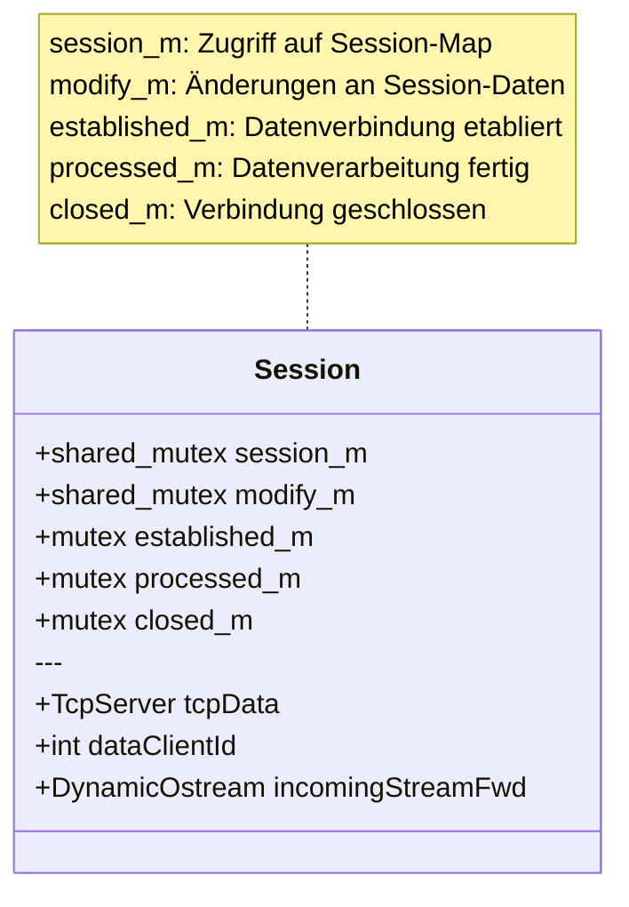
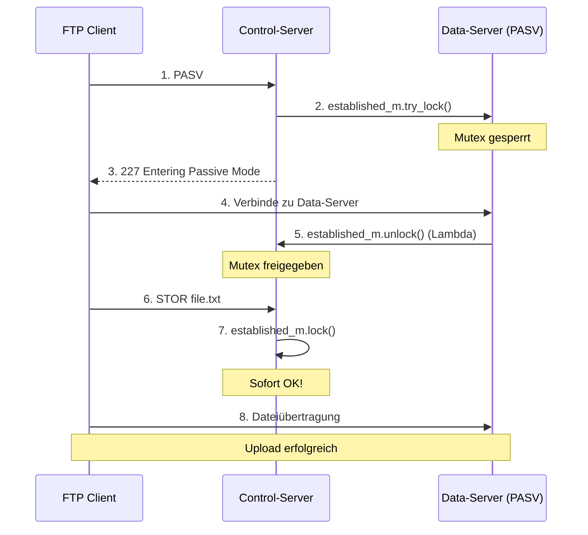
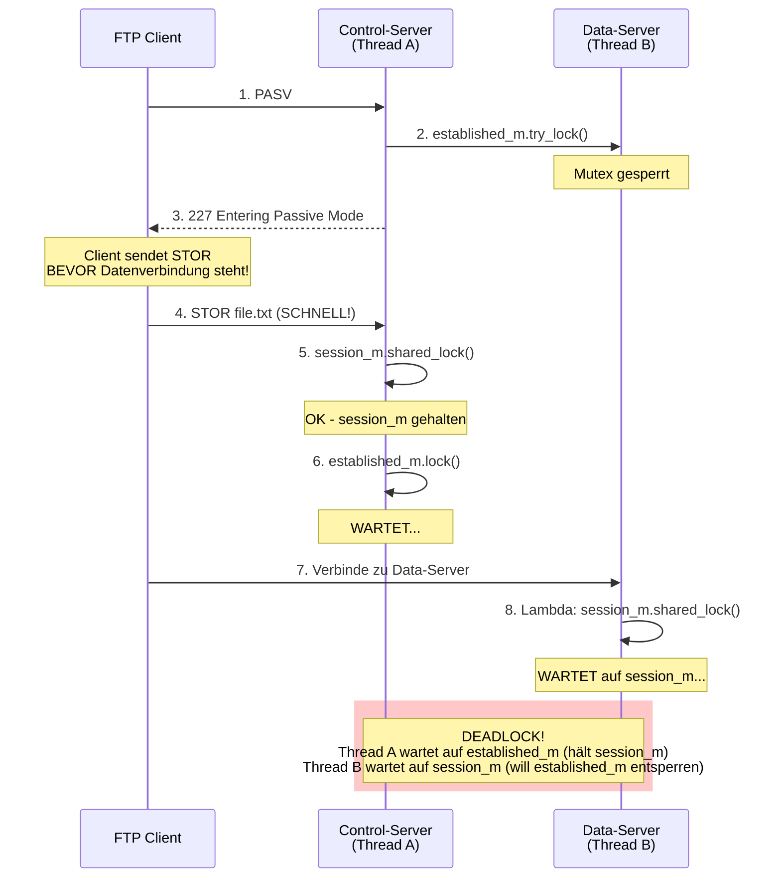
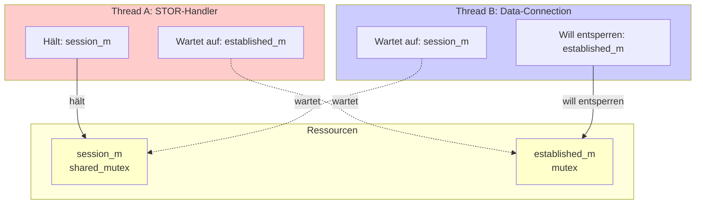
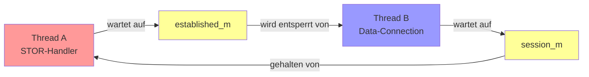
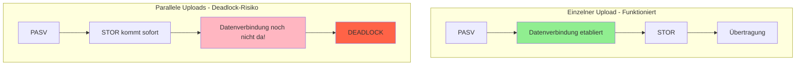
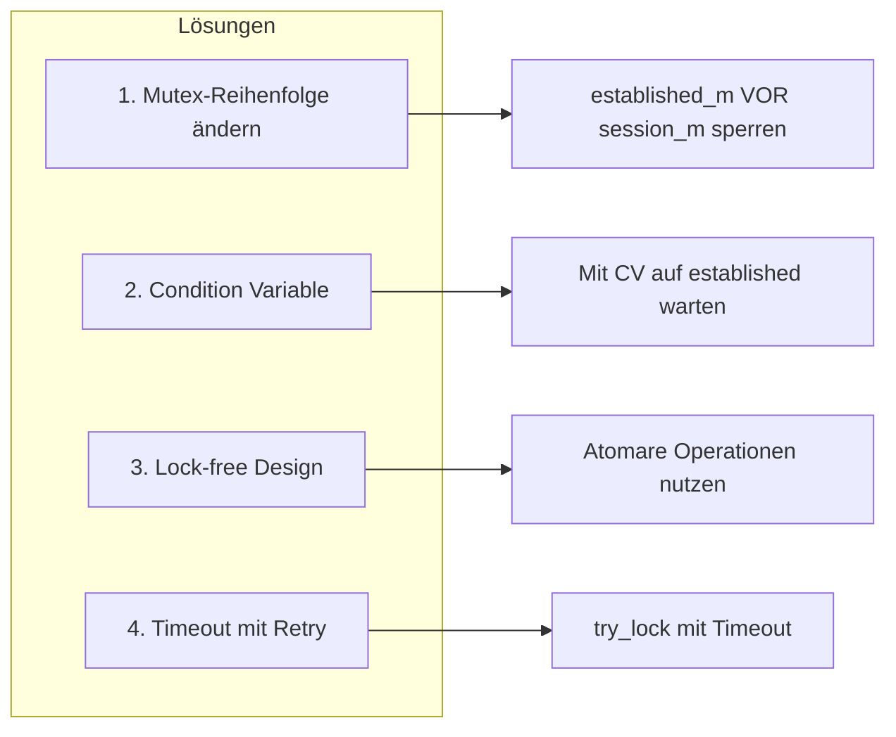

# Issue #14: Deadlock bei parallelen FTP-Dateiübertragungen

## Übersicht

Der FTP-Server bleibt bei parallelen Dateiübertragungen hängen. Das Problem tritt auf, wenn mehrere Dateien gleichzeitig hochgeladen werden (z.B. 5+ parallele Uploads).

## Symptom

Die Debug-Ausgabe zeigt, dass der Server bei der 5. parallelen Datei stecken bleibt:

```
DEBUG 1-5
DEBUG 2-5
--> Stuck at session->established_m.lock();
```

---

## Beteiligte Komponenten

### Mutex-Hierarchie in der Session



---

## Normaler Ablauf (funktioniert)



---

## Fehlerhafter Ablauf (Deadlock)

Bei schnellen parallelen Anfragen kann folgendes passieren:



---

## Detaillierte Code-Analyse

### 1. PASV-Befehl sperrt `established_m`

**Datei:** `FtpServer.cpp:456-459`

```cpp
bool _;
_ = p_established_m->try_lock(); // Sperrt established_m
_ = p_processed_m->try_lock();
_ = p_closed_m->try_lock();
```

### 2. Lambda-Callback soll `established_m` entsperren

**Datei:** `FtpServer.cpp:437-444`

```cpp
dataServer->setCreateForwardStream(
    [pp_incomingStreamFwd, p_established_m, p_session_m, p_dataClientId]
    (const int dataClientId) -> DynamicOstream<...>* {
        shared_lock<shared_mutex> lck_session{*p_session_m}; // ← Braucht session_m!
        *p_dataClientId = dataClientId;
        *pp_incomingStreamFwd = new DynamicOstream<...>();
        p_established_m->unlock();  // ← Soll established_m entsperren
        return *pp_incomingStreamFwd;
    });
```

### 3. STOR-Befehl wartet auf `established_m`

**Datei:** `FtpServer.cpp:698-703`

```cpp
void FtpServer::on_msg_fileUpload(...) {
    shared_lock<shared_mutex> lck_session{session_m}; // ← Hält session_m!
    cout << "DEBUG 1-" << clientId << endl;
    unique_ptr<Session> &session{activeSessions.at(clientId)};
    shared_lock<shared_mutex> lck_session_modify{session->modify_m};
    cout << "DEBUG 2-" << clientId << endl;
    session->established_m.lock();  // ← WARTET auf established_m!
    cout << "DEBUG 3-" << clientId << endl;  // ← Wird nie erreicht
    ...
}
```

---

## Deadlock-Visualisierung



### Zirkuläre Abhängigkeit



---

## Warum tritt das Problem nur bei parallelen Uploads auf?

```mermaid
gantt
    title Timing-Vergleich
    dateFormat X
    axisFormat %s

    section Einzelner Upload (OK)
    PASV           :a1, 0, 1
    Datenverbindung:a2, 1, 3
    STOR           :a3, 3, 4
    Übertragung    :a4, 4, 6

    section Parallele Uploads (Deadlock)
    PASV           :b1, 0, 1
    STOR (zu früh!):crit, b2, 1, 2
    Datenverbindung:b3, 2, 4
```



### Erklärung



---

## Zusammenfassung

| Aspekt | Beschreibung |
|--------|--------------|
| **Problem** | Deadlock bei parallelen Dateiübertragungen |
| **Ursache** | Zirkuläre Mutex-Abhängigkeit zwischen `session_m` und `established_m` |
| **Auslöser** | STOR-Befehl wird empfangen, bevor die Datenverbindung etabliert ist |
| **Betroffene Methoden** | `on_msg_fileUpload` (Zeile 703), `setCreateForwardStream` Lambda (Zeile 439) |
| **Reproduzierbar** | Bei 5+ parallelen Uploads mit schnellem Client |

---

## Mögliche Lösungsansätze



1. **Mutex-Reihenfolge ändern**: `established_m` vor `session_m` sperren
2. **Condition Variable nutzen**: Statt direktem Lock auf `established_m` mit Condition Variable warten
3. **Lock-free Design**: Atomare Operationen für den `established`-Status verwenden
4. **Timeout mit Retry**: Lock-Versuch mit Timeout und Retry-Mechanismus
