# Issue #14: Deadlock bei parallelen FTP-Dateiübertragungen

## Übersicht

Der FTP-Server bleibt bei parallelen Dateiübertragungen hängen. Das Problem tritt auf, wenn mehrere Dateien gleichzeitig hochgeladen werden (z.B. 5+ parallele Uploads).

## Symptom

Die Debug-Ausgabe zeigt, dass der Server bei der 5. parallelen Datei stecken bleibt:

```
DEBUG 1-5
DEBUG 2-5
--> Stuck at session->established_m.lock();
```

---

## Exkurs: shared_mutex und Lock-Typen

### Was ist ein shared_mutex?

Ein `shared_mutex` ist ein Mutex, der zwei Arten von Sperren unterstützt:

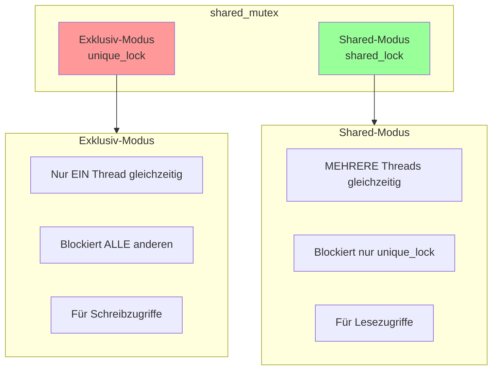

### Kompatibilitätsmatrix

| Thread A hält | Thread B will shared_lock | Thread B will unique_lock |
|---------------|---------------------------|---------------------------|
| **shared_lock** | ✅ Erlaubt | ❌ Blockiert |
| **unique_lock** | ❌ Blockiert | ❌ Blockiert |

### Wichtig für dieses Issue

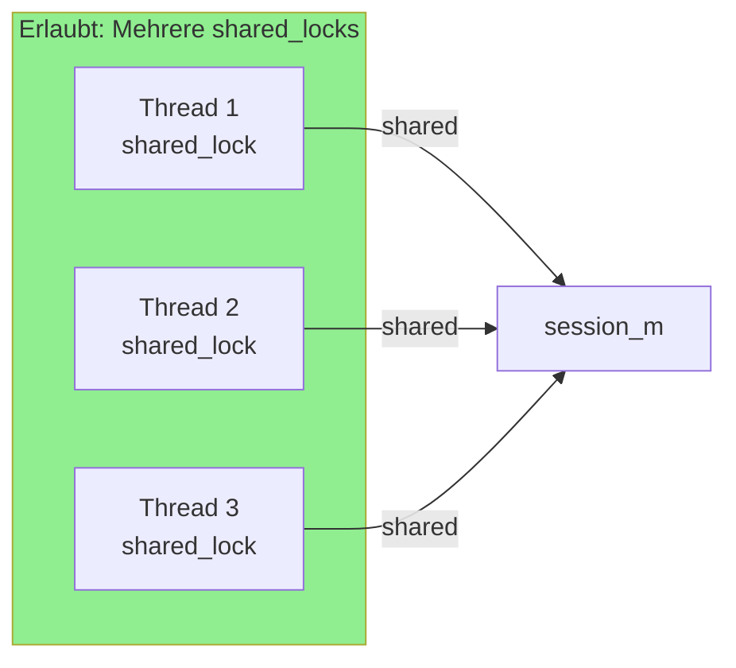

**Das bedeutet:** Wenn Thread A einen `shared_lock` auf `session_m` hält und Thread B ebenfalls einen `shared_lock` möchte, wird Thread B **NICHT blockiert**!

---

## Beteiligte Komponenten

### Mutex-Hierarchie in der Session

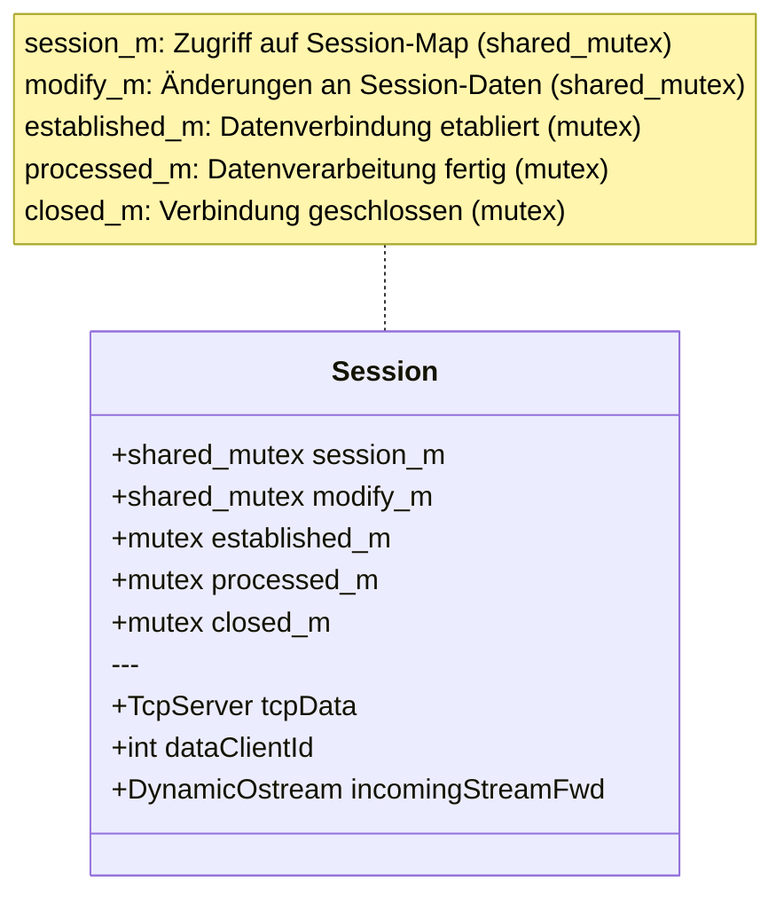

### Lock-Verwendung im Code

| Stelle | Mutex | Lock-Typ | Blockiert andere shared_locks? |
|--------|-------|----------|-------------------------------|
| `on_msg_fileUpload:698` | `session_m` | `shared_lock` | ❌ Nein |
| `on_msg_fileUpload:701` | `modify_m` | `shared_lock` | ❌ Nein |
| `on_msg_fileUpload:703` | `established_m` | `.lock()` | ✅ Ja (normaler mutex) |
| `on_msg_fileUpload:711` | `modify_m` | `unique_lock` | ✅ Ja |
| Lambda:439 | `session_m` | `shared_lock` | ❌ Nein |

---

## Korrigierte Deadlock-Analyse

Da `session_m` nur mit `shared_lock` gesperrt wird, kann der Deadlock **nicht** durch `session_m` entstehen. Das Problem liegt woanders:

### Der wahre Deadlock-Mechanismus

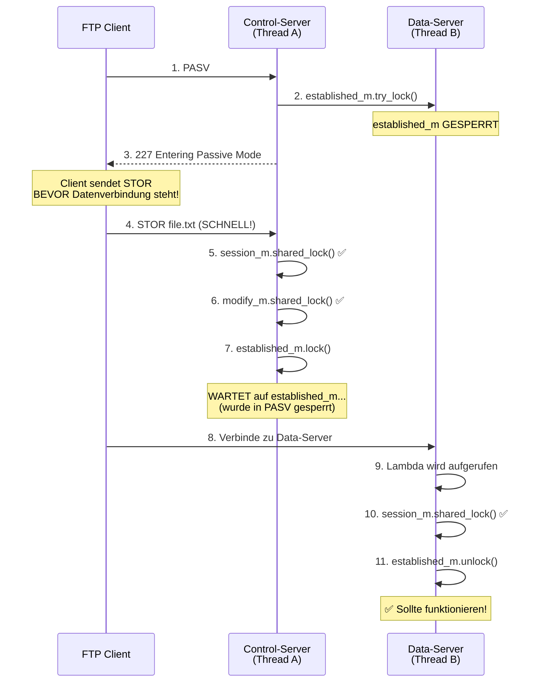

### Aber warum blockiert es dann?

Das Problem ist subtiler. Schauen wir uns den Code genauer an:


### Das eigentliche Problem: `modify_m` unique_lock

Der Deadlock entsteht durch die Kombination von:

1. **Thread A (STOR)**: Hält `modify_m` als `shared_lock`, wartet auf `established_m`
2. **Thread C (anderer PASV/STOR)**: Will `modify_m` als `unique_lock`

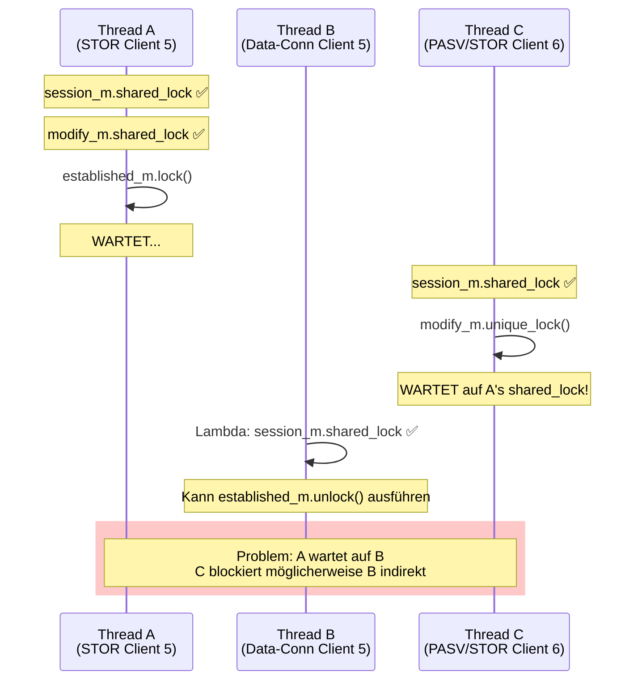

---

## Hypothese: Writer-Starvation Problem

Bei `shared_mutex` gibt es ein bekanntes Problem: **Writer-Starvation** oder **Reader-Writer-Fairness**.

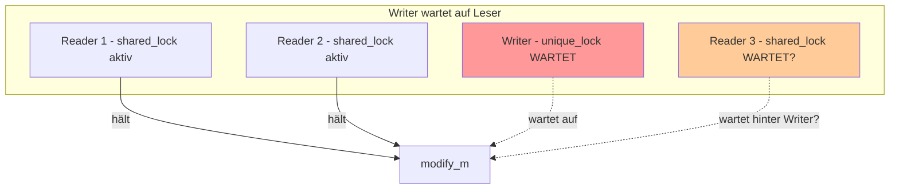

**Je nach Implementierung** kann ein wartender `unique_lock` neue `shared_lock`-Anfragen blockieren, um Writer-Starvation zu vermeiden. Das könnte erklären, warum das Lambda blockiert!

---

## Detaillierte Code-Analyse

### 1. PASV-Befehl sperrt `established_m`

**Datei:** `FtpServer.cpp:456-459`

```cpp
bool _;
_ = p_established_m->try_lock(); // Sperrt established_m
_ = p_processed_m->try_lock();
_ = p_closed_m->try_lock();
```

### 2. Lambda-Callback soll `established_m` entsperren

**Datei:** `FtpServer.cpp:437-444`

```cpp
dataServer->setCreateForwardStream(
    [pp_incomingStreamFwd, p_established_m, p_session_m, p_dataClientId]
    (const int dataClientId) -> DynamicOstream<...>* {
        shared_lock<shared_mutex> lck_session{*p_session_m}; // shared_lock auf session_m
        *p_dataClientId = dataClientId;
        *pp_incomingStreamFwd = new DynamicOstream<...>();
        p_established_m->unlock();  // Entsperrt established_m
        return *pp_incomingStreamFwd;
    });
```

### 3. STOR-Befehl wartet auf `established_m`

**Datei:** `FtpServer.cpp:698-711`

```cpp
void FtpServer::on_msg_fileUpload(...) {
    shared_lock<shared_mutex> lck_session{session_m};         // shared_lock
    unique_ptr<Session> &session{activeSessions.at(clientId)};
    shared_lock<shared_mutex> lck_session_modify{session->modify_m}; // shared_lock

    session->established_m.lock();  // WARTET hier!

    // Nach established_m.lock():
    lck_session_modify.unlock();
    unique_lock<shared_mutex> lck_session_modify_unique{session->modify_m}; // unique_lock!
    ...
}
```

---

## Mögliche Deadlock-Szenarien

### Szenario 1: Parallele Sessions mit shared modify_m

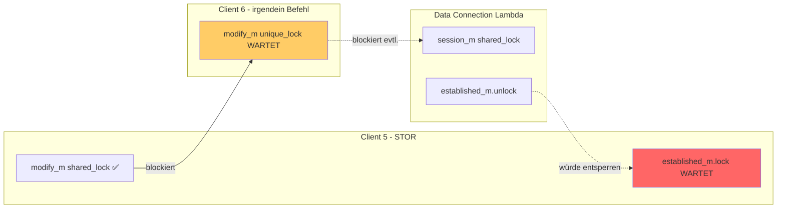

### Szenario 2: tcpPort_m Mutex

In `on_msg_modePassive` wird `tcpPort_m` gelockt (Zeile 410):

```cpp
lock_guard<mutex> lck_port{tcpPort_m};
```

Wenn mehrere PASV-Befehle gleichzeitig verarbeitet werden, warten sie hier aufeinander.

---

## Normaler Ablauf (funktioniert)

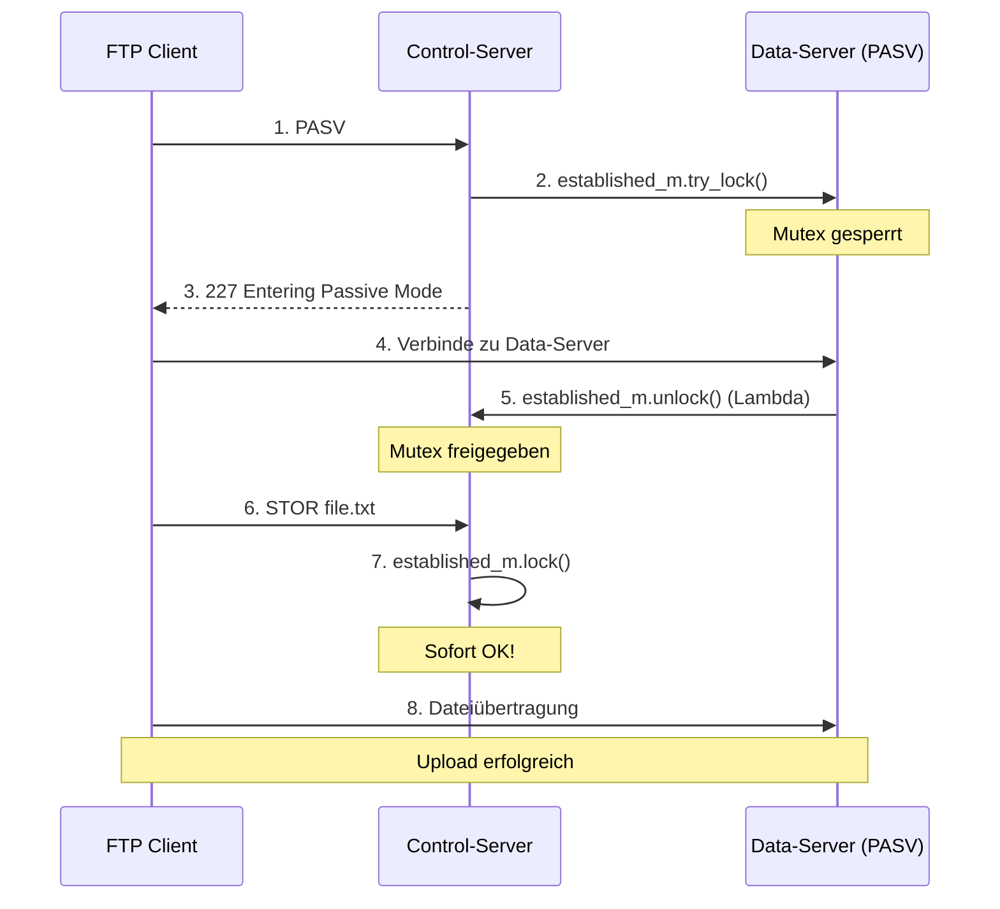

---

## Warum tritt das Problem nur bei parallelen Uploads auf?

```mermaid
gantt
    title Timing-Vergleich
    dateFormat X
    axisFormat %s

    section Einzelner Upload (OK)
    PASV           :a1, 0, 1
    Datenverbindung:a2, 1, 3
    STOR           :a3, 3, 4
    Übertragung    :a4, 4, 6

    section Parallele Uploads (Deadlock)
    PASV           :b1, 0, 1
    STOR (zu früh!):crit, b2, 1, 2
    Datenverbindung:b3, 2, 4
```

### Erklärung

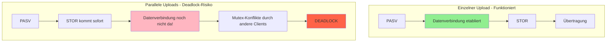

Bei parallelen Uploads konkurrieren mehrere Threads um dieselben Mutexe, was zu komplexen Warteabhängigkeiten führt.

---

## Zusammenfassung

| Aspekt | Beschreibung |
|--------|--------------|
| **Problem** | Deadlock bei parallelen Dateiübertragungen |
| **Symptom** | Server bleibt bei `established_m.lock()` hängen |
| **Ursache** | Komplexe Mutex-Interaktionen zwischen `established_m`, `modify_m` und möglicherweise `tcpPort_m` bei parallelen Requests |
| **shared_mutex Verhalten** | `shared_lock` erlaubt mehrere gleichzeitige Leser, aber `unique_lock` blockiert alle |
| **Betroffene Methoden** | `on_msg_fileUpload` (Zeile 703), `on_msg_modePassive` (Zeile 456), Lambda (Zeile 439) |
| **Reproduzierbar** | Bei 5+ parallelen Uploads mit schnellem Client |

---

## Mögliche Lösungsansätze

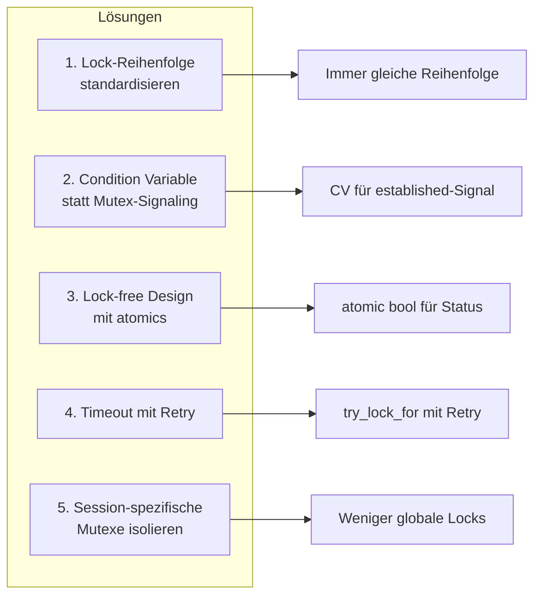

1. **Lock-Reihenfolge standardisieren**: Alle Threads müssen Mutexe in derselben Reihenfolge sperren
2. **Condition Variable nutzen**: Statt direktem Lock auf `established_m` mit `condition_variable` warten
3. **Lock-free Design**: Atomare Operationen (`std::atomic<bool>`) für den `established`-Status verwenden
4. **Timeout mit Retry**: `try_lock_for()` mit Timeout und Retry-Mechanismus
5. **Session-spezifische Mutexe isolieren**: Weniger Abhängigkeiten zwischen globalen und session-lokalen Locks

---

## Weiterführende Untersuchung

Um den genauen Deadlock zu identifizieren, wäre hilfreich:

1. **Thread-Dump** während des Deadlocks (z.B. mit `gdb`)
2. **Lock-Order-Checker** wie ThreadSanitizer (`-fsanitize=thread`)
3. **Logging** aller Lock/Unlock-Operationen mit Thread-ID und Zeitstempel
