# Issue #14: Deadlock bei parallelen FTP-Dateiübertragungen

## Übersicht

Der FTP-Server bleibt bei parallelen Dateiübertragungen hängen. Das Problem tritt auf, wenn mehrere Dateien gleichzeitig hochgeladen werden (z.B. 5+ parallele Uploads).

## Symptom

Die Debug-Ausgabe zeigt, dass der Server bei der 5. parallelen Datei stecken bleibt:

```
DEBUG 1-5
DEBUG 2-5
--> Stuck at session->established_m.lock();
```

---

## Exkurs: shared_mutex und Lock-Typen

### Was ist ein shared_mutex?

Ein `shared_mutex` ist ein Mutex, der zwei Arten von Sperren unterstützt:

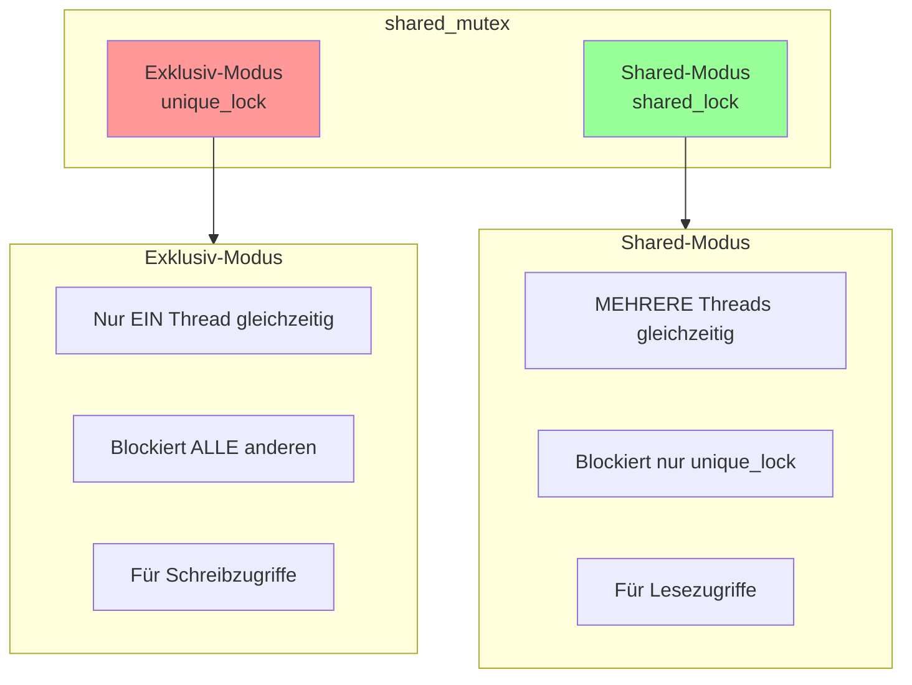

### Kompatibilitätsmatrix

| Thread A hält | Thread B will shared_lock | Thread B will unique_lock |
|---------------|---------------------------|---------------------------|
| **shared_lock** | ✅ Erlaubt | ❌ Blockiert |
| **unique_lock** | ❌ Blockiert | ❌ Blockiert |

### Wichtig für dieses Issue

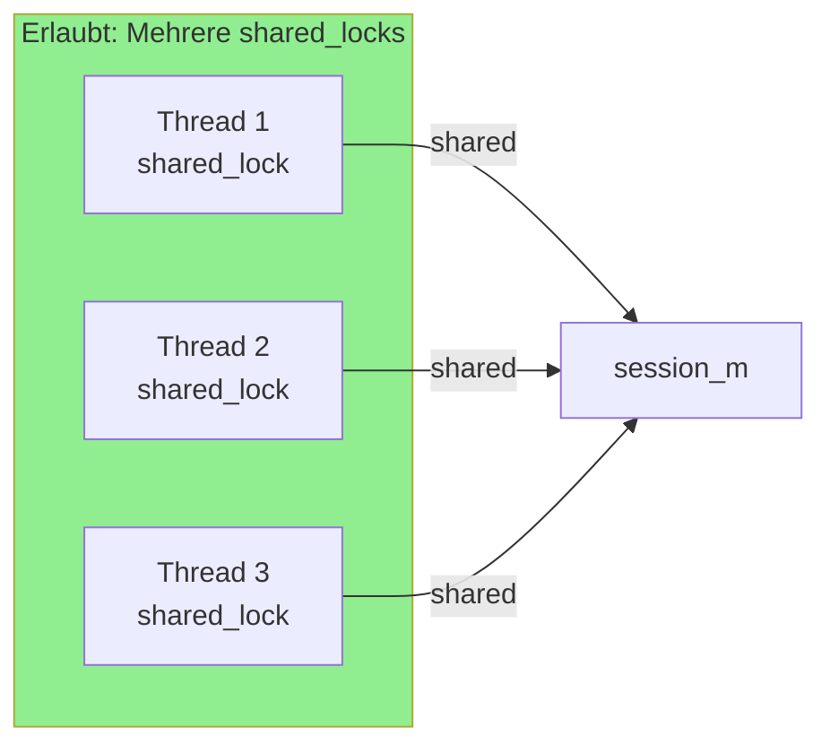

**Das bedeutet:** Wenn Thread A einen `shared_lock` auf `session_m` hält und Thread B ebenfalls einen `shared_lock` möchte, wird Thread B **NICHT blockiert**!

---

## Exkurs: Dynamisch erzeugte Mutexe

### Session-Struktur mit eigenen Mutexen

Jede `Session` wird dynamisch für jeden verbundenen Client erstellt und enthält **eigene Mutex-Instanzen**:

```cpp
struct Session {
    // ... andere Felder ...
    std::mutex established_m;    // Pro Session!
    std::mutex processed_m;      // Pro Session!
    std::mutex closed_m;         // Pro Session!
    std::shared_mutex modify_m;  // Pro Session!
};
```

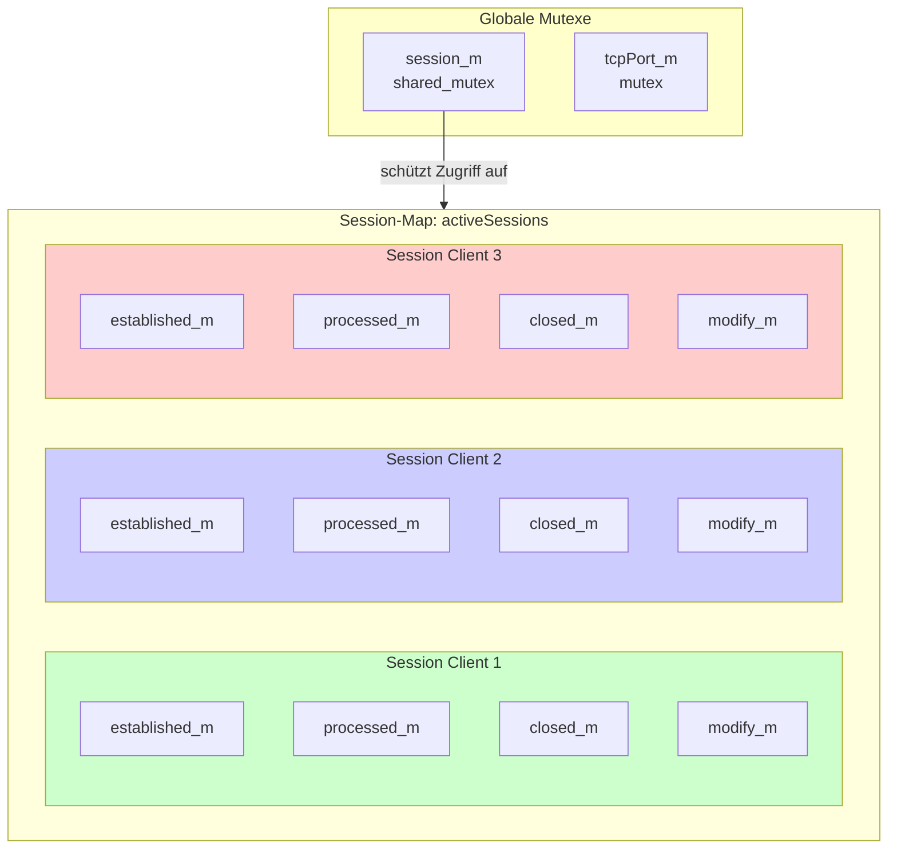

### Was bedeutet das?

1. **Isolation**: Client 1's `established_m` ist eine **komplett andere Mutex-Instanz** als Client 2's `established_m`
2. **Keine Cross-Session-Blockierung**: Ein Lock auf `session1->established_m` blockiert **niemals** `session2->established_m`
3. **Nur globale Mutexe** können Sessions gegenseitig blockieren: `session_m` und `tcpPort_m`

### Lebenszyklus dynamischer Mutexe

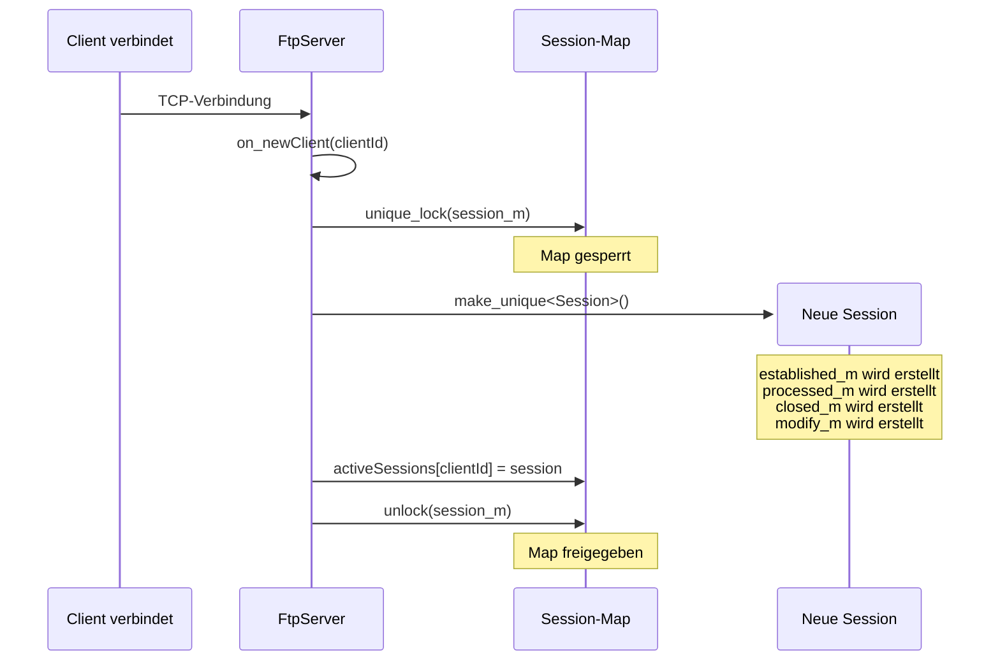

### Wichtig: Pointer auf Mutexe in Lambdas

Im Code werden **Pointer auf die Session-Mutexe** in Lambdas gespeichert:

```cpp
// In on_msg_modePassive (Zeile 428-431):
mutex *p_established_m{&session->established_m};  // Pointer auf Session-Mutex!
mutex *p_processed_m{&session->processed_m};
mutex *p_closed_m{&session->closed_m};
```

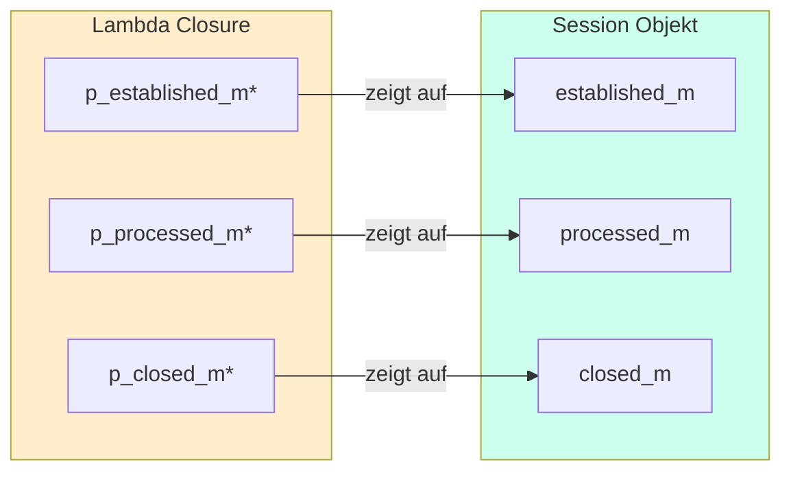

**Gefahr:** Wenn die Session gelöscht oder verschoben wird, zeigen die Pointer auf ungültigen Speicher!

---

## Beteiligte Komponenten

### Mutex-Übersicht

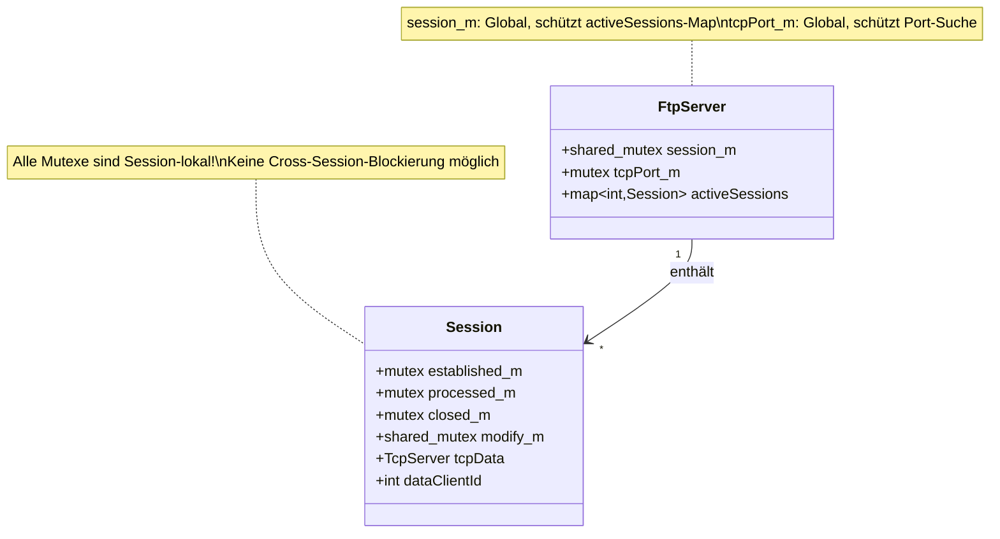

---

## Korrigierte Deadlock-Analyse

Da jede Session ihre eigenen Mutexe hat, kann der Deadlock **nur innerhalb einer einzelnen Session** entstehen - zwischen dem STOR-Handler-Thread und dem Data-Connection-Lambda-Thread **desselben Clients**.

### Der Deadlock-Mechanismus

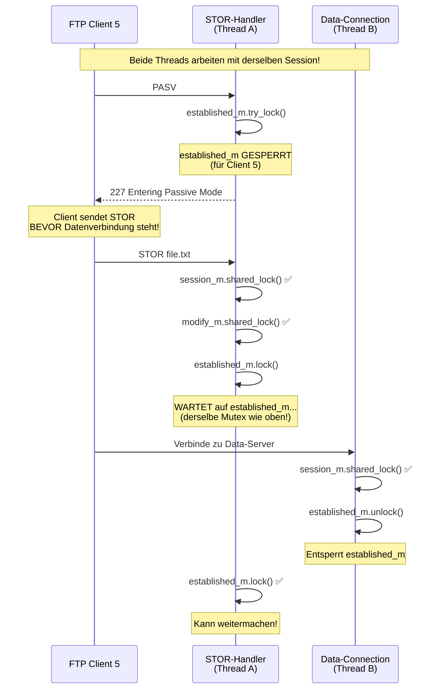

### Aber warum blockiert es dann?

Das Problem liegt im **Timing** und möglicherweise in der **Reihenfolge der Mutex-Operationen**:

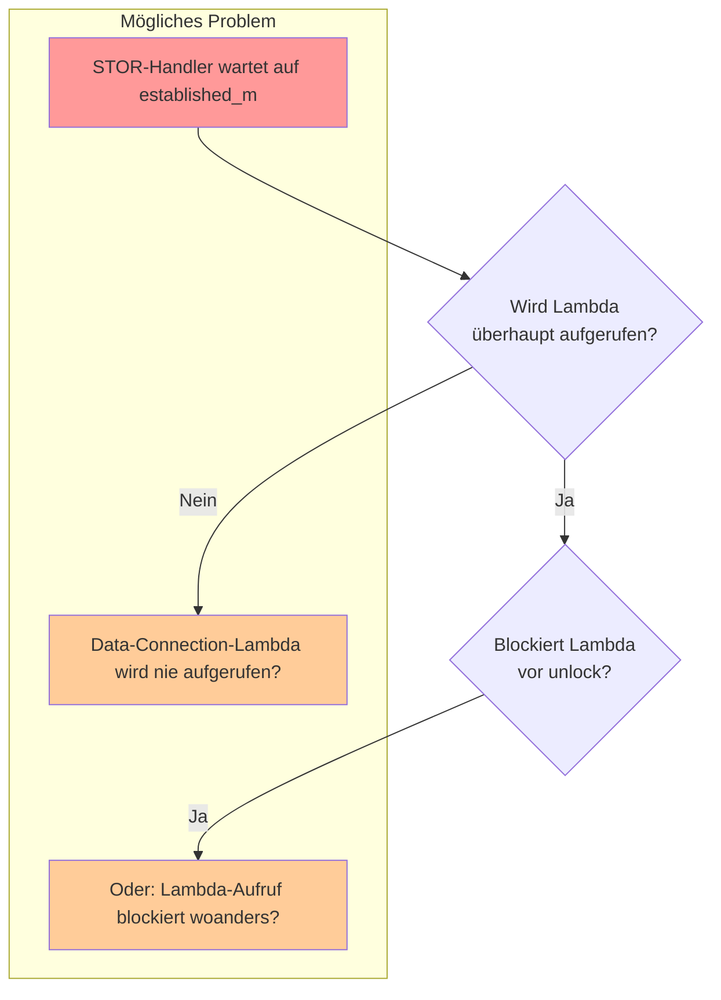

---

## Hypothese: Das Lambda wird nie aufgerufen

Schauen wir uns an, wann das Lambda aufgerufen wird:

```cpp
dataServer->setCreateForwardStream([...](const int dataClientId) -> DynamicOstream<...>* {
    shared_lock<shared_mutex> lck_session{*p_session_m};
    *p_dataClientId = dataClientId;
    *pp_incomingStreamFwd = new DynamicOstream<...>();
    p_established_m->unlock();  // <-- Entsperrt established_m
    return *pp_incomingStreamFwd;
});
```

Das Lambda wird aufgerufen, wenn ein **Client sich mit dem Data-Server verbindet**.

### Timing-Problem

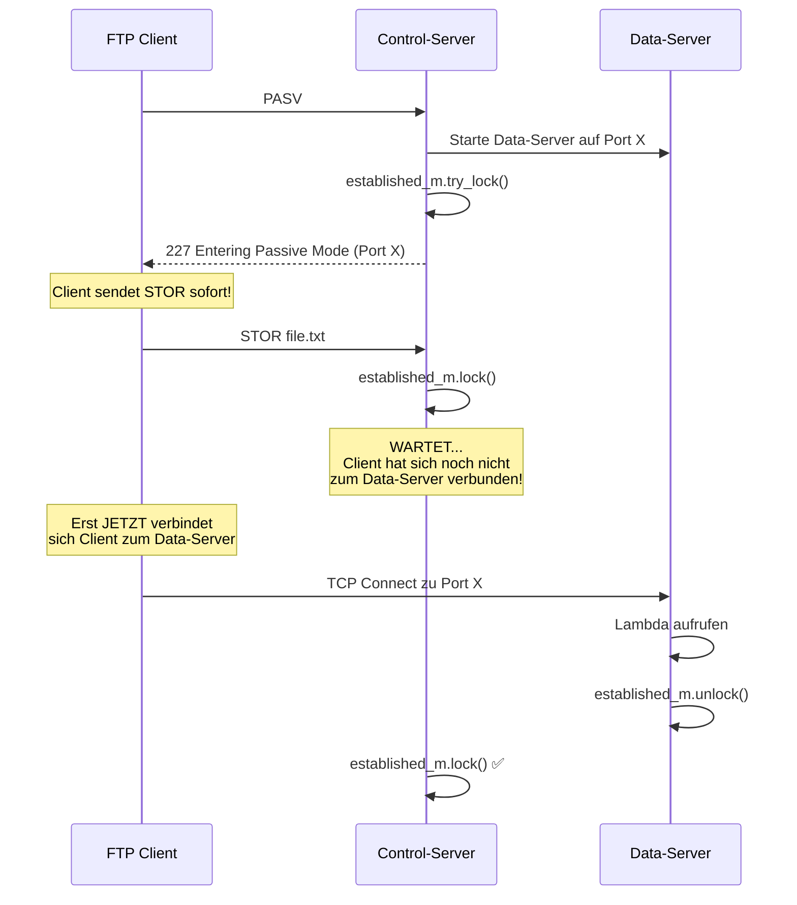

**Das sollte eigentlich funktionieren!** Der STOR-Handler wartet einfach, bis der Client sich verbindet.

---

## Neue Hypothese: tcpPort_m blockiert

In `on_msg_modePassive` gibt es einen `lock_guard` auf `tcpPort_m`:

```cpp
// Zeile 410
lock_guard<mutex> lck_port{tcpPort_m};
```

Dieser Lock wird **vor** dem Starten des Data-Servers genommen und erst am Ende des Scopes freigegeben.

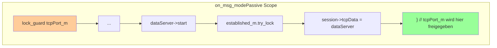

### Das Problem bei parallelen PASV-Befehlen

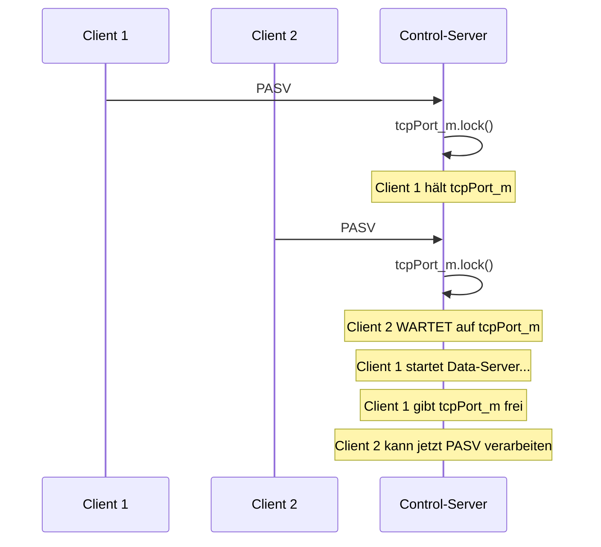

**Das erklärt aber nicht den Deadlock**, da `tcpPort_m` sequentiell verarbeitet wird.

---

## Kritische Erkenntnis: Data-Server-Start im tcpPort_m-Lock

Das eigentliche Problem könnte sein:

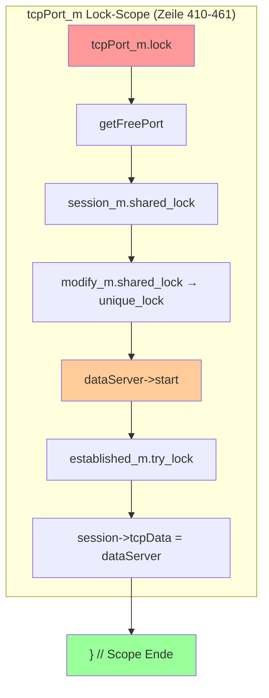

Der Data-Server wird **innerhalb** des `tcpPort_m`-Locks gestartet. Wenn das Lambda aufgerufen wird, versucht es `session_m.shared_lock()` zu bekommen.

**Aber:** Der PASV-Handler hält bereits `session_m.shared_lock()` - das ist kein Problem, da beides `shared_lock` ist.

---

## Die wahrscheinlichste Ursache

Nach genauerer Analyse: **Das Lambda wird möglicherweise im falschen Kontext aufgerufen** oder **der Data-Server ist noch nicht bereit**.

Schauen wir uns die Reihenfolge an:

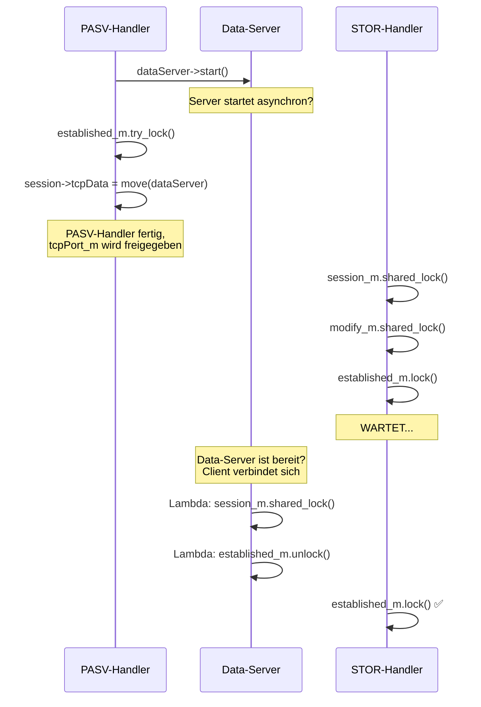

### Mögliche Race Condition

Was passiert, wenn der **Client sich sehr schnell verbindet** - noch während PASV läuft?

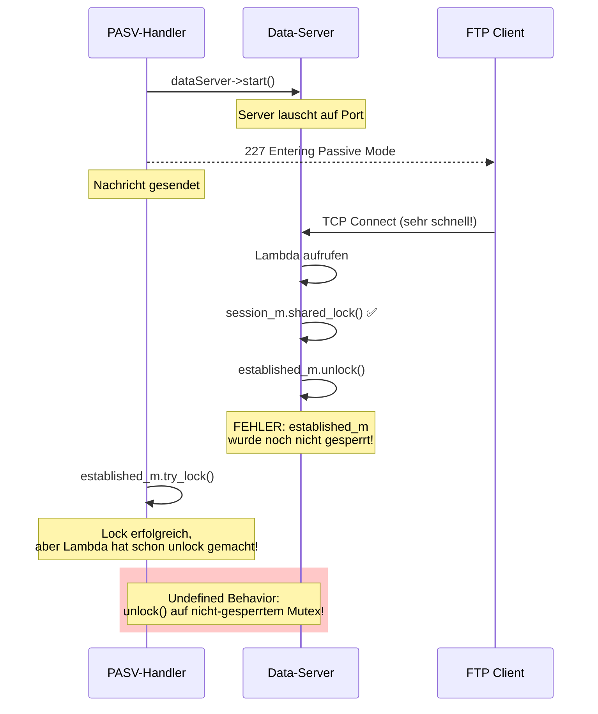

---

## Fazit: Race Condition bei schneller Verbindung

Das Problem ist eine **Race Condition**:

1. `dataServer->start()` wird aufgerufen (Zeile 451)
2. Die Antwort `227 Entering Passive Mode` wird gesendet (Zeile 486)
3. **Erst danach** wird `established_m.try_lock()` aufgerufen (Zeile 457)

Wenn der Client sich **zwischen Schritt 1 und 3** verbindet, ruft das Lambda `established_m.unlock()` auf einem **nicht gesperrten Mutex** auf!

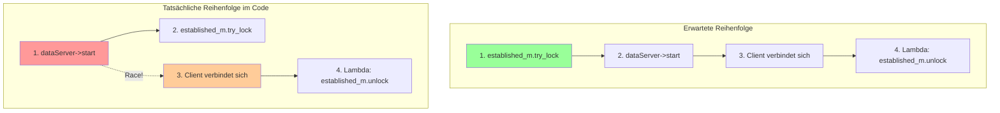

---

## Zusammenfassung

| Aspekt | Beschreibung |
|--------|--------------|
| **Problem** | Deadlock/Undefined Behavior bei parallelen Dateiübertragungen |
| **Symptom** | Server bleibt bei `established_m.lock()` hängen |
| **Ursache** | Race Condition: `dataServer->start()` wird **vor** `established_m.try_lock()` aufgerufen |
| **Folge** | Lambda kann `unlock()` auf nicht-gesperrtem Mutex aufrufen → Undefined Behavior |
| **Betroffene Stelle** | `FtpServer.cpp:451-459` |
| **Session-Mutexe** | Sind pro Client isoliert, keine Cross-Session-Blockierung |

---

## Lösung

Die Reihenfolge muss korrigiert werden:

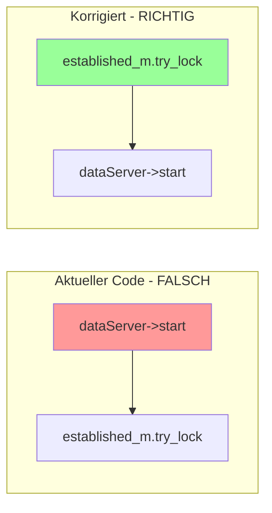

**Konkret:** Zeile 457 (`established_m.try_lock()`) muss **vor** Zeile 451 (`dataServer->start()`) verschoben werden.

---

## Mögliche Lösungsansätze

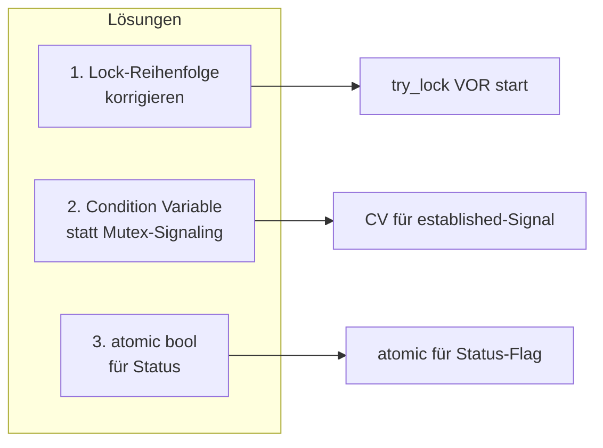

1. **Lock-Reihenfolge korrigieren**: `established_m.try_lock()` **vor** `dataServer->start()` aufrufen
2. **Condition Variable nutzen**: Statt Mutex-Missbrauch eine `condition_variable` für Signaling verwenden
3. **Atomic Flag**: `std::atomic<bool>` für den `established`-Status verwenden
